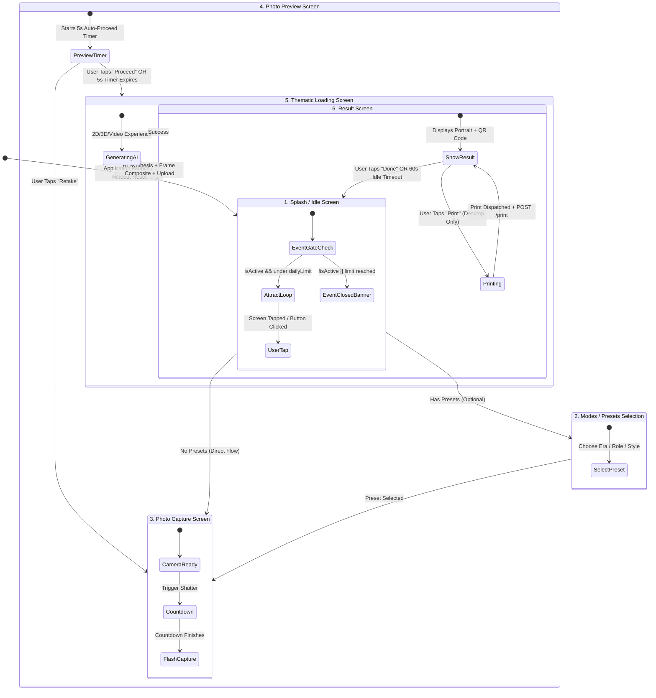

# Photobooth Screen Flow & Navigation Architecture

This skill defines the standardized screen navigation flow, pre-implementation discovery interview, output branding/compositing modes, and UI/UX patterns for 5DVR interactive photobooth applications (**Desktop Electron Kiosks** and **Browser/Mobile Web Booths**).

---

## 0. Mandatory Pre-Implementation Discovery Interview ("Grill-Me Protocol")

> [!IMPORTANT]
> **STOP & INTERVIEW BEFORE SCAFFOLDING**:
> Developers are encouraged to kick off new booths using `/grill-me` + the project's `.md` integration guide exported from the 5DVR Dashboard **Developer** tab. Even if `/grill-me` was not invoked, **always inspect any existing `public/assets` folder first and interview the developer (`ask_question`) to resolve every unknown below before writing code**:
> 1. **Platform Type**: Desktop Electron Kiosk (`desktop`) vs. Browser/Mobile Web App (`web`)?
> 2. **Mode / Era Selection Flow**: Single unified theme (`Splash -> Capture`) vs. Multi-Era / Mode selector (`era_selection` with 2–4 cards)?
> 3. **Input Image Strategy**: 1-image identity-only (`IMAGE 1` guest photo) vs. Dual-Image (`IMAGE 1` guest photo + `IMAGE 2` empty scene/monument reference plates in `public/assets/Era-References/`)?
> 4. **Output Branding & Frame Mode *(Not All Projects Have Frames!)***:
>    - **`'ornate_frame'`**: Custom PNG border/medallion overlay (`frame.png`) — requires `15%` top / `12%` side safe margins in prompts + frame compositing.
>    - **`'logo_only'`**: Corner/footer sponsor or event badges only — no border frame inset (`~8%` top headroom).
>    - **`'unframed'`**: Raw full-bleed portrait — no frame or logo overlay (`~6%` overscan breathing room on printed kiosks; zero inset on Web).
> 5. **UI & Media Assets**: Are designed screen assets (`Screens-Assets`), frames (`Eras-Frames`), and loading `.mp4` videos already supplied locally, or should bespoke UI + animations be created?
> 6. **2D vs. 3D Visuals**: Lightweight 2D transitions/video loops vs. Three.js / React Three Fiber 3D countdown & loading effects?
> 7. **Hardware Defaults *(Desktop Kiosks only)***: Physical camera mount rotation (`-90°` sideways portrait vs. `0°` landscape) and printer target (`DNP DP-QW410`, `Canon SELPHY CP1500`, or QR-only)?

---

## 1. Complete Screen Flow State Machine



---

## 2. Screen Specifications & Behavioral Rules

### Screen 1: Splash / Idle (Attract) Screen
- **Event Gate Check**: Enforce `cloudConfig.isActive` and `cloudConfig.currentGenerations < cloudConfig.dailyLimit` from the Dashboard's `GET /settings` (and live `POST /generate` updates). Disable starting new sessions with a clear status banner when finished or at limit.
- **Behavior**: Resets all temporary state, face data, and previous session outputs. Tapping CTA transitions to **Screen 2** (if multi-era/mode) or **Screen 3** (if single theme).

### Screen 2: Eras / Modes / Presets Selection Screen *(Optional)*
- Grid or carousel of mode cards with visual thumbnail, title, and subtitle.
- Selecting a different mode resets that mode's sequential variation index (`selectActiveEra(era)`) and advances to **Screen 3 (Capture)**. Includes a configurable idle timeout (default `30s`) returning to **Screen 1**.

### Screen 3: Photo Capture Screen
- **Configurable Physical Camera Transform (Desktop Kiosk)**:
  - Many 5DVR kiosks mount cameras sideways (`cameraRotation = -90`), while others mount upright (`0`). Drive both the live `<video>` CSS transform and the hidden capture `<canvas>` rotation dynamically from `operatorSettings.cameraRotation` (`-90 | 0 | 90 | 180`) and `cameraMirror` (`scaleX(-1)`).
  - For `-90°` mirrored portrait kiosks:
    ```css
    position: absolute;
    top: 50%;
    left: 50%;
    transform: translate(-50%, -50%) scaleX(-1) rotate(-90deg);
    width: 100vh;
    height: 100vw;
    object-fit: cover;
    ```
- **No Face-Align HUD Overlays**: Keep the camera viewport 100% clean (no oval face guides or head silhouettes) so solo guests and groups of 2–6+ frame naturally.
- **Instant Countdown Freeze**: At `0`, immediately snapshot the upright frame to `<canvas>`, hide the countdown overlay so numbers never linger, run `detectFaces(uprightCanvas, true)` asynchronously, and transition to **Screen 4 (Preview)**.

### Screen 4: Photo Preview Screen (With Mandatory 5s Auto-Proceed)
- Shows captured photo, `"Retake"`, `"Proceed"`, and a visual countdown bar/ring (default **5 seconds**).
- If the countdown expires without interaction, **automatically proceed to Screen 5 (Loading)** so exhibition queues never stall when guests step back to admire the screen.

### Screen 5: Thematic Loading Screen (2D / 3D / Video)
- Entertains guests during AI synthesis (themed `.mp4` loop, canvas particles, or R3F 3D scene + milestone status text + smooth progress up to 92%).
- Pipeline:
  1. Generate portrait via `photobooth-model-providers` (`OpenAI` or `Gemini` per `cloudConfig.aiModelProvider`).
  2. Apply conditional branding/frame compositing (if `FramingMode !== 'unframed'`).
  3. Save local archive copy (on Desktop Electron) + upload to Cloudinary (`cloudinary-photobooth-upload` with `prompt_0, prompt_1...` context) + fire non-blocking `POST /generate` (`photobooth-metrics-api`).
  4. Advance to **Screen 6 (Result)**.

### Screen 6: Result Screen
- Displays final portrait + high-contrast QR code (`photobooth-qr-generator`, with graceful loading/retry state if venue Wi-Fi is slow).
- **Desktop Kiosk Only**: Shows `"Print Photo"` when `operatorSettings.enablePrinting` is true, enforcing `singlePrintPerSession` if enabled and calling non-blocking `POST /print` with `{ copies }`.
- **Web App Only**: Offers native mobile download / Web Share button alongside QR.
- Auto-resets to **Screen 1 (Splash)** after idle timeout (default `60s`).

---

## 3. Conditional Output Branding & Frame Compositor Modes

Match your `compositorService.ts` to the project's confirmed `FramingMode`:

1. **`'ornate_frame'` (Custom PNG Border / Medallion Frame — `1200x1800` 300 DPI)**:
   - Inspect actual frame dimensions and alpha channel first.
   - If the frame PNG has **transparent outer margins** (e.g. curved lotus corners or protruding top/bottom logo medallions like `Egyptian-Museum-Photobooth`), run a cached **BFS flood-fill outer-alpha mask** seeded from the 4 canvas edges up to `alpha >= 220` (dilated by `2px`) to zero out portrait alpha *outside* the frame rim while filling 100% of the inner window cleanly, then draw `frameImg` on top and export lossless `image/png`.
   - If the frame is a full-bleed rectangular border with no transparent exterior, draw the `2:3` portrait over `1200x1800` and draw `frameImg` directly on top.
2. **`'logo_only'` (Sponsor / Event Badges Only)**:
   - Draw the `2:3` portrait full-bleed on `1200x1800` and composite crisp vector/PNG badges in the designated corner or footer bar.
3. **`'unframed'` (Full-Bleed Portrait)**:
   - Skip frame compositing altogether and pass the clean portrait directly to Cloudinary, QR, and printing. *(Note: printer edge padding belongs strictly in `photobooth-photo-printing`, never baked into the digital download image.)*

---

## 4. 3D Three.js & Dynamic Typography Standards

- **3D Kiosk Optimization**: Cap particles at `1,000–3,000` on integrated GPUs, use non-PBR materials (`photobooth-3d-scene-optimization`), disable antialiasing when needed, and dispose WebGL resources on unmount.
- **Dynamic Typography**: Avoid flat static kiosk headings—use subtle breathing glows, metallic/thematic gradients, and responsive button states.

---

## 5. Operator Settings & Cloud AI Model Lock

- **Desktop Kiosks (`desktop`)**: Follow [photobooth-operator-settings](../photobooth-operator-settings/SKILL.md). `F2` controls **local hardware & timing only** (`operator-settings.json`). The AI model, API keys, and Cloudinary target are **locked on the 5DVR Dashboard** (`GET /settings` → `cloud-config.cache.json`) and shown read-only in `F2`.
- **Web Apps (`web`)**: No `F2` modal, no `operator-settings.json`, and no printing; fetch `GET /settings` strictly on the server.
